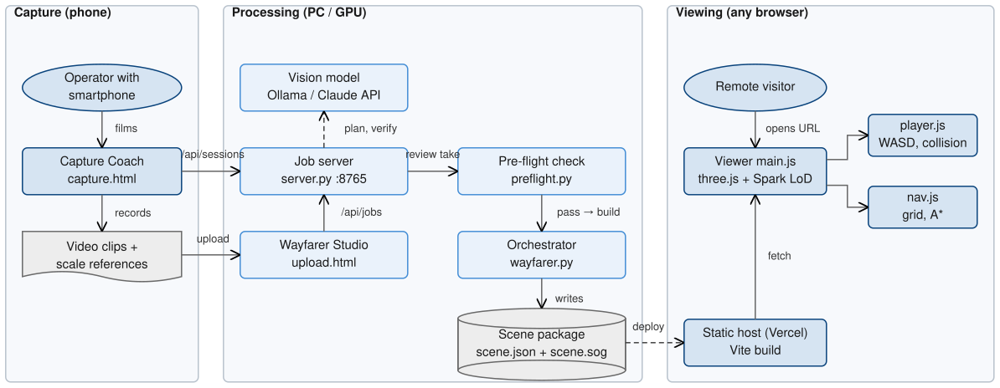
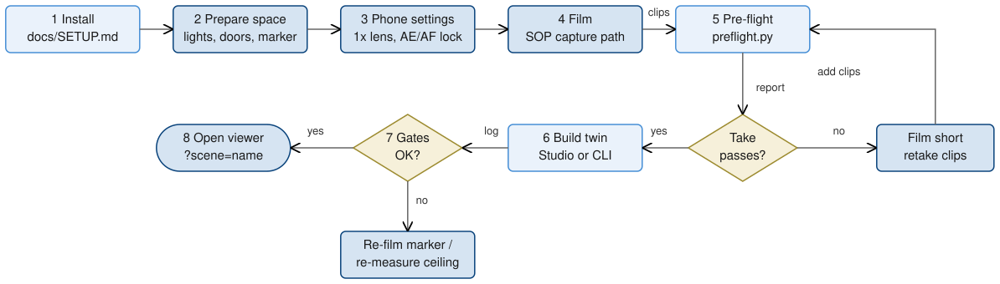

Repository: <https://github.com/ayush-jadaun/Wayfarer> · Live viewer: <https://wayfarer-ten-kappa.vercel.app/> 
Demo video: <https://drive.google.com/file/d/1haPZGPQqfS8M_v1reZNNYYvk4NMd-9Gs/view>

**Overview.** Wayfarer replaces static 2D floor plans with a photorealistic 3D twin that anyone can walk through in a web browser. One command turns an ordinary smartphone walkthrough into a 3D Gaussian-splat model and a metric occupancy grid. The grid gives the model a level floor, real-world scale and a map of where a person can walk. A zero-install viewer streams the compressed model and supports first-person WASD + mouse roaming with collision against real walls and furniture. Round 1 covers the capture procedure, the reconstruction and free roaming. The same grid already drives point-of-interest (POI) search and obstacle-aware A* routing, which are needed for Round 2.

# System Architecture

The system has three tiers, one per actor (Fig. 1). **Capture** runs on the operator's phone. The *Capture Coach* page (`web/capture.html`) guides recording live and uploads clips. **Processing** runs on one PC. A standard-library HTTP job server (`pipeline/server.py`, port 8765, proxied at `/api` by `web/vite.config.js`) accepts uploads from the *Wayfarer Studio* page (`web/upload.html`) or Coach sessions. It sends survey and verification photos to a vision model (`pipeline/coach.py`: local Ollama with Qwen2.5-VL by default, or the Claude API) and runs the fast capture check (`pipeline/preflight.py`). It then starts the orchestrator (`pipeline/wayfarer.py`). Splat training needs a CUDA GPU; our team trains on a local GPU or a Kaggle T4 (`pipeline/kaggle_train.py`, `kaggle_job.py`). **Viewing** is a static Vite build of `web/`, deployed on Vercel. `main.js` loads the scene and renders it with three.js and Spark; `player.js` handles movement and collision, `nav.js` the grid and routing, `minimap.js` the top-down map.

{: style="width:100%" }

The only contract between processing and viewing is the **scene package** in `web/public/scenes/<name>/`. `scene.json` holds the grid as plain-text rows (`.` walkable, `#` wall, `o` furniture), cell size and origin, floor and eye height, the spawn point, the splat transform and the POIs. `scene.sog` is the compressed splat. Because the grid is text, a wall the scan missed can be fixed in an editor. Every pipeline step writes its output to disk and is skipped when that output exists, so an interrupted build resumes (`--force <step>` re-runs from a step). The pipeline also accepts photo folders, several overlapping room clips, or a finished RGB-D scan (`pipeline/import_rgbd.py`), which skips camera-pose recovery and training.

# Pipeline Design

Fig. 2 shows the five resumable steps of `wayfarer.py` and the files passed between them.

1. **frames**: FFmpeg samples candidates at 8 fps, scaled to a longest side of 1280 px (1600 px for `--quality high`). In each window the sharpest frame by variance of the Laplacian is kept, up to 500 frames.
2. **sfm**: COLMAP 4.2 is run directly: GPU SIFT with 8,192 features and one shared OPENCV camera. Matching is exhaustive up to 150 frames, otherwise sequential with loop detection. Camera poses come from the global mapper. The largest model is kept, implausibly distant cameras are dropped, and the run stops with a hint when fewer than 50 % of frames register.
3. **train**: nerfstudio `splatfacto` (gsplat kernels) trains for 7k/30k/40k/50k iterations depending on `--quality`, resuming from the last checkpoint.
4. **export**: `ns-export` writes `splat.ply`. `ns-eval` scores held-out frames (PSNR/SSIM/LPIPS) into `stats.json`, which ships inside `scene.json`.
5. **navgrid**: `navgrid.py` levels, scales and aligns the splat, builds the occupancy grid and compresses the splat to SOG (Section 4.3).

Post-steps label objects (`autopoi.py`), texture the floor and ceiling (`surfaces.py`) and draw a vector floor plan (`floorplan.py`). Optional flags mask out people (`--mask-people`, `masks.py`) and repair unseen views with a diffusion model (`--ai-repair`, `airepair.py`).

{: style="width:100%" }

# SOP Details

The capture rules are in `docs/SOP.md`. The numbers the automatic checks use are in `pipeline/capture_requirements.md`. Fig. 3 shows the procedure end to end.

1. **Install** (once, `docs/SETUP.md`): Python 3.10 environment with PyTorch 2.1.2, nerfstudio 1.1.5 and the prebuilt gsplat 1.4.0 wheel; COLMAP 4.2+, FFmpeg and Node.js 20 on `PATH`; `npm install` in `web/`. Optionally install Ollama and run `ollama pull qwen2.5vl:7b` for the AI coach.
2. **Prepare the space**: all lights on, fans and moving objects off, interior doors open, screens off and large mirrors covered. Print `docs/marker.svg` at 100 % (150 mm square), stick it flat within about 2 m of the path, and tape-measure one floor-to-ceiling height.
3. **Configure the phone**: 1× main lens, landscape, 4K/30 or 1080p/60, exposure and focus locked, stabilisation on, HDR/night mode off.
4. **Film**: in each room, walk a perimeter loop 0.5–1 m from the walls at chest height (about 1.4 m), facing the room and tilted 10–15° down. Stop 2 s at each corner and sweep 90°, then make one ceiling sweep and an along-the-wall pass at 30–45° to each wall. Film the marker for about 5 s from 3 or more angles. Cross doorways slowly with about 3 s of overlap, and finish where you started. Walk at most 0.5 m/s and turn at most 30°/s.
5. **Check the take**: the Coach review, or `python pipeline/preflight.py walk.mp4`, flags blur, fast turns, dark or blank-wall stretches and exposure jumps with timestamps. It also runs COLMAP on 120 frames (≥ 90 % must register in one model) and checks view angles (median ray spread ≥ 15°). Failures come back as short retake clips to film.
6. **Build**: run `start.bat`, drop the clips into Wayfarer Studio and press *Build twin*, or run `python pipeline/wayfarer.py walk.mp4 --name home --ceiling 2.75`.
7. **Check the gates** in the log: share of frames kept and registered, a single model, the three scale estimates agreeing within 12 %, and walkable area plausible for the space. If the scale disagrees, re-film the marker or re-measure the ceiling.
8. **Open and publish**: `npm run dev` and open `?scene=<name>`, or `npm run build` and deploy `web/dist`. Visitors roam with WASD + mouse, Shift to run, F to fly, M for the map and `/` to search.

{: style="width:100%" }

# Technical Approach

## Blur-aware frame selection
Sharpness is the variance of the Laplacian on a 480 px greyscale thumbnail. A window's best frame is rejected only if it falls below 0.55× the sharpest frame within ±2 s, not below a global median. A plain wall is naturally low-contrast yet sharp, whereas motion blur is low *relative to its neighbours*. Photo folders keep every photo.

## Camera poses and splat training
Driving COLMAP directly, instead of through nerfstudio's wrapper, keeps loop detection on and lets us pick the largest model. On a home capture, the code records global mapping registering 284 of 292 frames in one model at 0.67 px in 6.5 min; incremental mapping split the same frames into two models in 17 min (`wayfarer.py`). Stray cameras farther than 10× the median distance are deleted, because they would squash the real poses during training. Training uses settings that fit an 8 GB GPU: images cached on the CPU as uint8, a per-image bilateral grid that absorbs exposure and white-balance shifts, scale regularisation against needle-shaped splats, and SO3×R3 pose refinement. A memory-capped gsplat MCMC trainer (`train_mcmc.py`) is the fallback for very large venues.

## Navigation-grid builder
A trained splat has no floor, no scale and no notion of what is solid; Fig. 4 shows how `navgrid.py` adds them.

- **Filtering and leveling**: splats with opacity below 0.3 are dropped. RANSAC fits the floor (500 hypotheses, tilt ≤ 25°) on the low layer, and the scene is rotated so the floor normal is +Y with the floor at y = 0.
- **Metric scale**: the scale comes from an ArUco marker (DICT_4X4_50, corners triangulated from 3+ views, sides agreeing within 5 %), else from the tape-measured ceiling against a fitted ceiling plane, else from a 1.4 m camera-height prior. Estimates more than 12 % apart are flagged.
- **Wall alignment**: a Manhattan yaw search rotates the scene so walls land on the grid axes.
- **Occupancy**: splats 0.12–1.9 m above the floor mark obstacles in 10 cm cells (walls above 1.2 m, furniture below). Optional depth carving (`depthcarve.py`) clears cells that rendered camera rays pass through, and blobs under 0.03 m² are discarded.
- **Walkability**: cells the camera physically walked through are always walkable, and only floor connected to that path is kept, which removes regions seen through windows and mirrors.
- **Web export**: PlayCanvas splat-transform compresses the splat to SOG, and the alignment is stored as a transform in `scene.json`.

{: style="width:100%" }

## Web viewer
Spark builds a level-of-detail tree in a worker, so each frame renders a bounded number of splats on any GPU. Splats are cut off at √5 standard deviations, and the full-detail foveation cone is widened to 130° so screen edges stay sharp (`main.js`). The walker is a 0.22 m circle, eye height 1.6 m, with exponential acceleration. Collision is resolved per axis against the grid, so the walker slides along walls (`player.js`); phones get a touch stick and drag-to-look. Routing (`nav.js`) uses 8-connected A* with an octile heuristic and no corner cutting, on a grid inflated by 0.3 m with a raw-grid fallback for tight doors, followed by line-of-sight smoothing. Search ranks exact, prefix, word-prefix, substring, description and subsequence matches (`main.js`).

## Results and verification
The live demo is the **"fast apartment"** twin built with `import_rgbd.py` from the public Redwood indoor apartment scan: a mesh, a metric trajectory, 31,919 RGB-D frames and a LIDAR scan registered automatically. It has **3,276,779 splats**. SOG compression shrinks the splat from **183.5 MB (PLY) to 22.3 MB (8.2×)**. The grid is 98 × 79 cells at 0.1 m with **38.4 m² walkable**, and **18 POIs** (4 rooms, 14 objects) were labelled automatically by `autopoi.py`. This twin is not a trained splat, so it has no held-out PSNR/SSIM. Automated tests cover the viewer (`web/test`: 6 navigation and 8 capture-metric tests). Python self-checks cover the grid builder on a synthetic tilted, rotated and scaled room (scale within 3 %, door walkable, table footprint), marker scale, the pre-flight check and the coach with its models stubbed.

# Credits

All third-party software, models, services and data used by Wayfarer and by this abstract (licence in parentheses; from the upstream projects where the repository does not state it):

- **three.js** 0.186 (MIT): WebGL scene, camera, labels
- **Spark** 2.3 (MIT): Gaussian-splat rendering with LoD
- **PlayCanvas splat-transform** 3.10 + **playcanvas** (MIT): PLY → SOG compression
- **@adobe/spz** (ISC): splat-transform dependency
- **Vite** 8.3 (MIT) with rolldown (MIT), LightningCSS (MPL-2.0), PostCSS (MIT): build and dev server
- **@vitejs/plugin-basic-ssl** (MIT): HTTPS for the phone Coach
- **Node.js** (MIT): tooling, `node --test`
- **NumPy** (BSD-3), **Pillow** (MIT-CMU), **SciPy** (BSD-3): numerics, images, rotations, KD-trees
- **OpenCV** (Apache-2.0): ArUco detection, image ops
- **PyTorch** 2.1.2, **torchvision** 0.16.2 (BSD-3): GPU tensors; Faster R-CNN MobileNet-V3 detector
- **COCO-pretrained weights** (torchvision; COCO data CC BY 4.0): object and person detection
- **nerfstudio** 1.1.5 (Apache-2.0): splatfacto training, export, evaluation
- **gsplat** 1.4.0 (Apache-2.0): CUDA rasteriser, MCMC trainer, depth rendering
- **COLMAP** 4.2 incl. global mapper (BSD-3): features, matching, SfM
- **FFmpeg** (LGPL-2.1+): frame extraction
- **scikit-image** (BSD-3), **PyMeshLab** (GPL-3.0): optional mesh export
- **simple-lama-inpainting** / LaMa (Apache-2.0): floor/ceiling inpainting
- **NVIDIA Difix3D**, `nvidia/difix_ref` (NVIDIA research licence): optional view repair
- **Ollama** (MIT) + **Qwen2.5-VL 7B** (Apache-2.0): local coach vision model
- **Anthropic Claude API** + `anthropic` SDK (MIT): optional coach provider
- **Kaggle** notebooks, T4 GPU, `kaggle` CLI (Apache-2.0): cloud training
- **Vercel**: static hosting of the viewer
- **uv** (MIT/Apache-2.0): Python environment setup
- **Redwood indoor RGB-D dataset**: apartment scan used for the demo
- **draw.io** file format via the drawio-skills CLI (MIT), **Python-Markdown** (BSD-3), **Google Chrome** headless (print to PDF), **PyMuPDF** (AGPL-3.0), **Pillow** (MIT-CMU): this document
- **drawio-skills** and **scientific-writing** agent skills (MIT): figure and writing workflow

